<p align="center">
  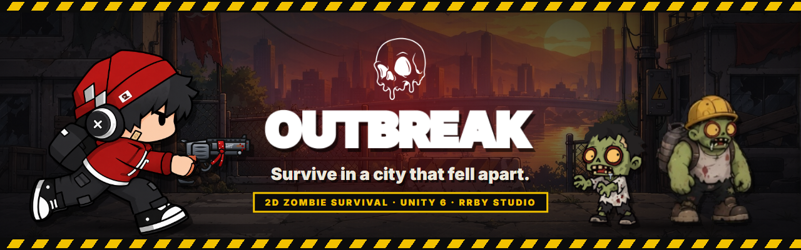
</p>

<p align="center">
  <a href="https://outbreak.zura-w.my.id"></a>
  
  
  
</p>

<p align="center">
  <b>OUTBREAK</b> adalah game <b>2D zombie survival lane shooter</b> buatan <b>RRBY Studio</b>.<br>
  Pilih hero, ambil senjata, dan bersihkan lima zona kota yang sudah runtuh dari serbuan zombie.
</p>

<p align="center">
  <a href="#-cuplikan-website">Cuplikan</a> •
  <a href="#-hero">Hero</a> •
  <a href="#-zona-misi">Zona</a> •
  <a href="#-senjata">Senjata</a> •
  <a href="#-cara-main">Cara main</a> •
  <a href="#-tim">Tim</a> •
  <a href="#-untuk-developer">Developer</a>
</p>

---

## 🧟 Cuplikan website

Repo ini adalah website resmi OUTBREAK yang online di **[outbreak.zura-w.my.id](https://outbreak.zura-w.my.id)**. Websitenya full-page scroll: satu scroll pindah satu layar, dengan preloader ala layar loading game, musik latar dari game, dan tampilan yang tetap rapi di HP.

<table>
  <tr>
    <td width="50%">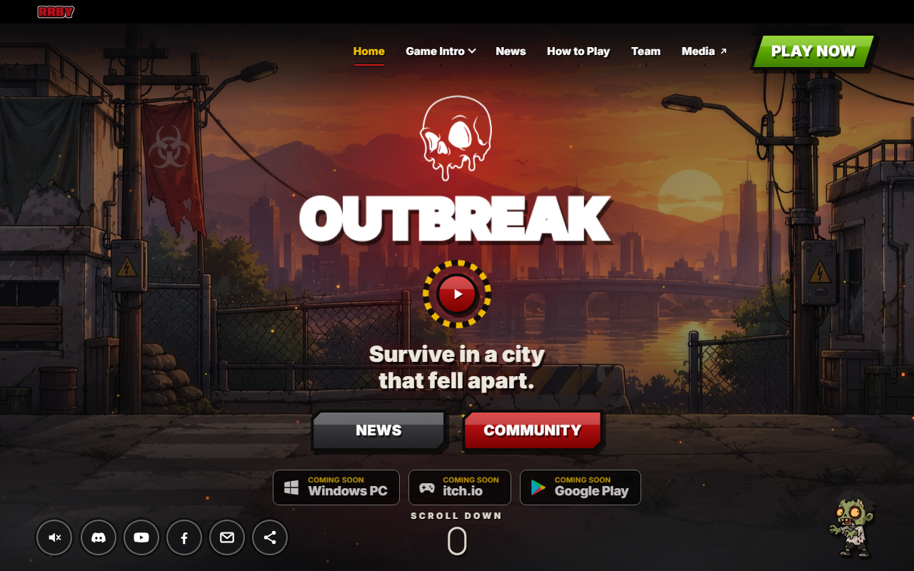<p align="center"><b>Home</b><br><sub>Logo, trailer, tombol download</sub></p></td>
    <td width="50%">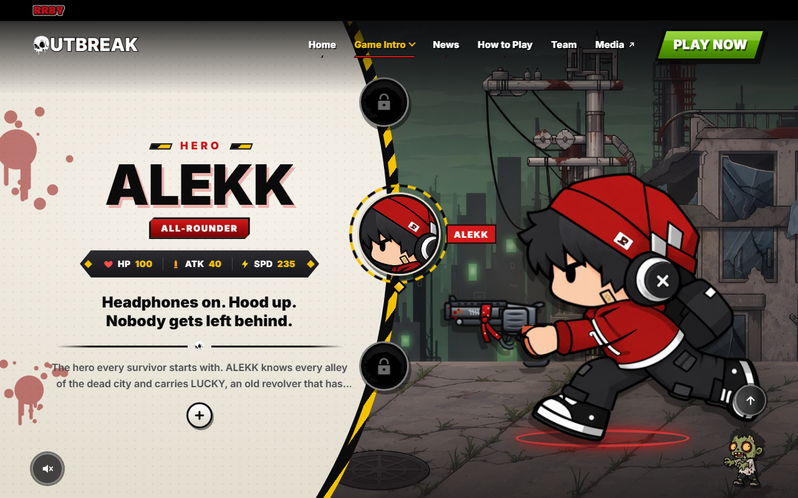<p align="center"><b>Heroes</b><br><sub>Roda potret hero di panel melengkung</sub></p></td>
  </tr>
  <tr>
    <td>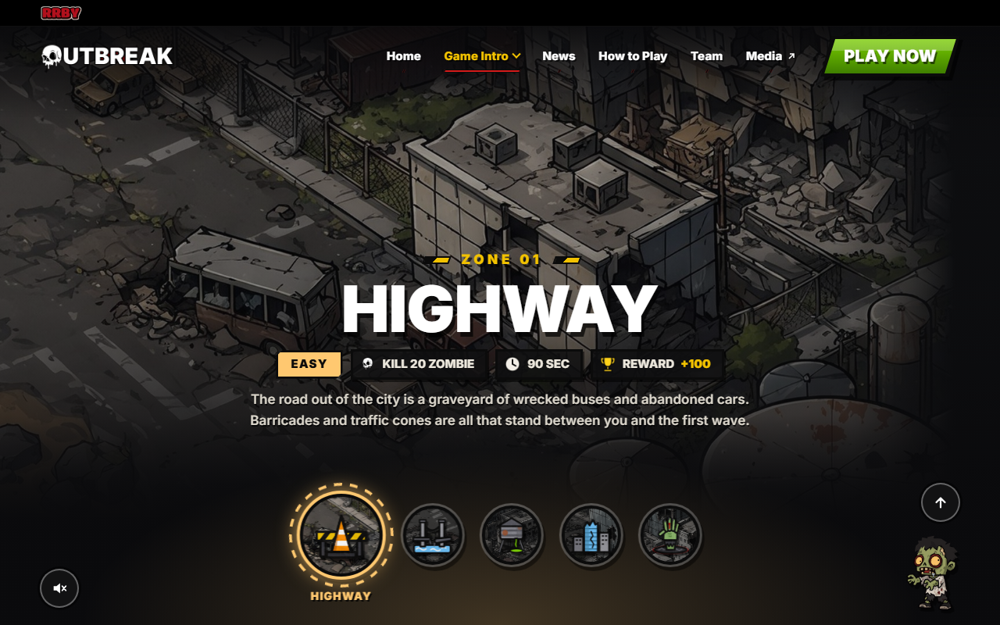<p align="center"><b>Zones</b><br><sub>Lima zona misi lengkap dengan target dan hadiah</sub></p></td>
    <td>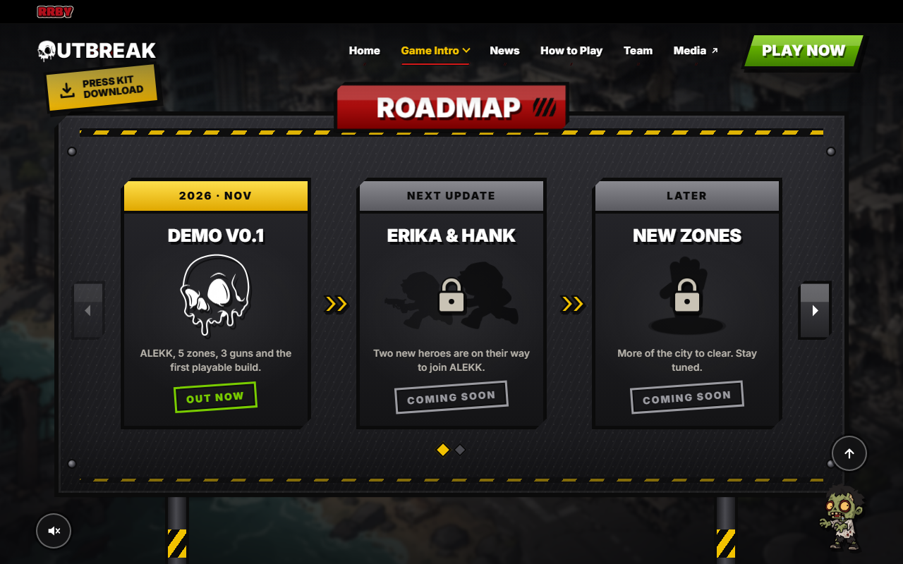<p align="center"><b>Roadmap</b><br><sub>Papan rencana update</sub></p></td>
  </tr>
  <tr>
    <td>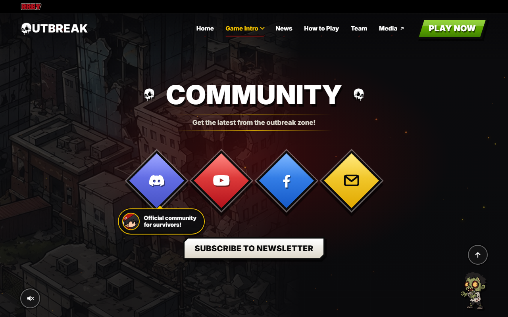<p align="center"><b>Community</b><br><sub>Sosial media dan newsletter</sub></p></td>
    <td>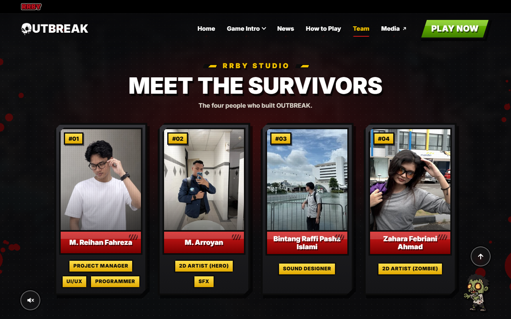<p align="center"><b>Team</b><br><sub>Orang-orang di balik OUTBREAK</sub></p></td>
  </tr>
</table>

## 🦸 Hero

| | Hero | Peran | HP | ATK | SPD | Status |
|:-:|---|---|:-:|:-:|:-:|---|
| 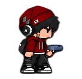 | **ALEKK** | All-Rounder | 100 | 40 | 235 | ✅ Bisa dimainkan |
|  | **ERIKA** | Speedster | ??? | ??? | ??? | 🔒 Coming soon |
|  | **HANK** | Tank | ??? | ??? | ??? | 🔒 Coming soon |

> *"Headphones on. Hood up. Nobody gets left behind."* — ALEKK

## 🗺️ Zona misi

| | Zona | Kesulitan | Target | Syarat | Hadiah |
|:-:|---|---|---|---|--:|
| 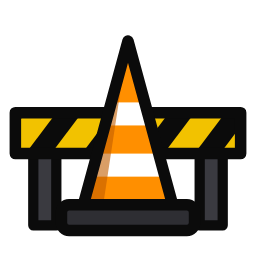 | **Highway** | 🟧 EASY | Kill 20 zombie | 90 detik | +100 |
| 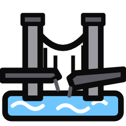 | **Bridge** | 🟩 NORMAL | Survive 150 detik | 4 wave, runner | +300 |
| 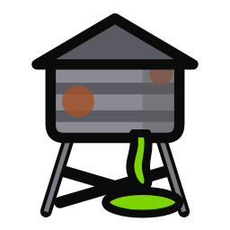 | **Water Tower** | 🟪 HARD | Pertahankan barikade | Kill 65, HP > 50% | +650 |
| 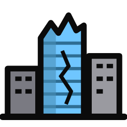 | **Downtown** | 🟦 EXPERT | Bertahan di kabut beracun | 240 detik, tanpa medkit | +1.400 |
| 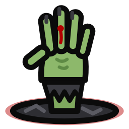 | **The Nest** | 🟥 NIGHTMARE | Kalahkan bos mutan | 100 zombie + TYRANT | +3.000 |

## 🔫 Senjata

| | Senjata | Damage | Amunisi |
|:-:|---|:-:|:-:|
| 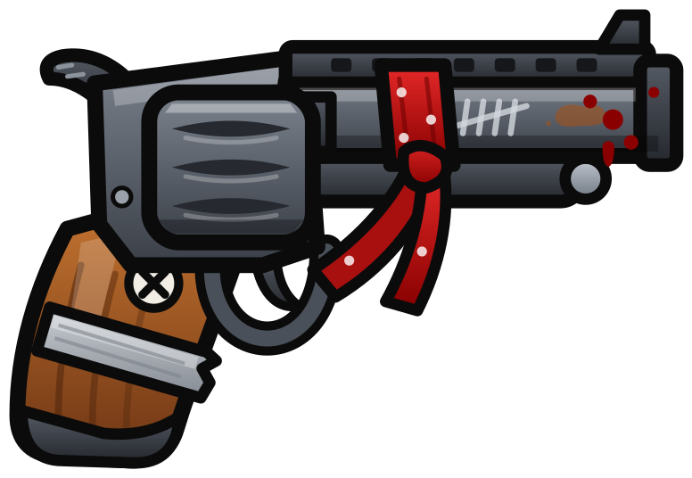 | **LUCKY** | 25 | 30 |
| 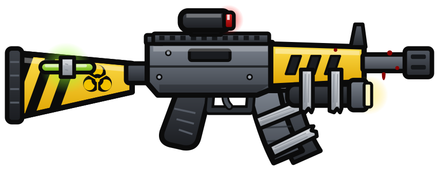 | **HAZMAT** | 42 | 45 |
| 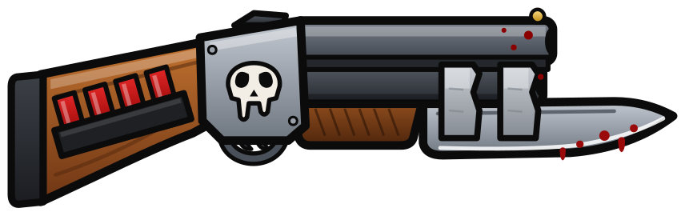 | **BUTCHER** | 16 × 7 | 8 |

## 🎮 Cara main

| Tombol | Aksi |
|---|---|
| <kbd>W</kbd> <kbd>A</kbd> <kbd>S</kbd> <kbd>D</kbd> | Bergerak |
| <kbd>Klik kiri</kbd> | Menembak |
| <kbd>E</kbd> | Pakai medkit (+50 HP) |
| <kbd>Q</kbd> | Pakai ammo box |

Selesaikan zona untuk dapat cash, lalu belanjakan untuk senjata dan medkit di SHOP.

## 👥 Tim

<table>
  <tr>
    <td align="center" width="25%">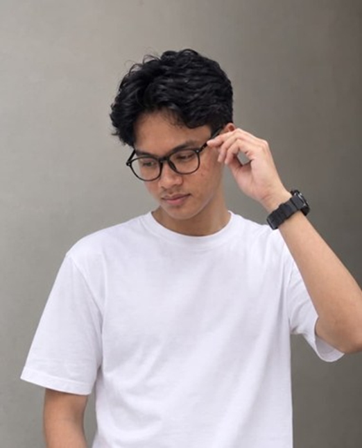<br><b>M. Reihan Fahreza</b><br><sub>Project Manager · UI/UX · Programmer</sub></td>
    <td align="center" width="25%">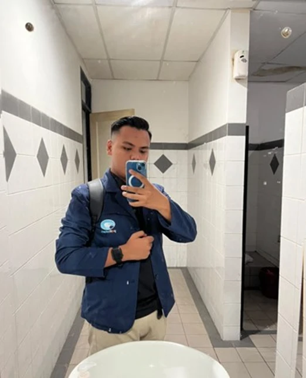<br><b>M. Arroyan</b><br><sub>2D Artist (Hero) · SFX</sub></td>
    <td align="center" width="25%">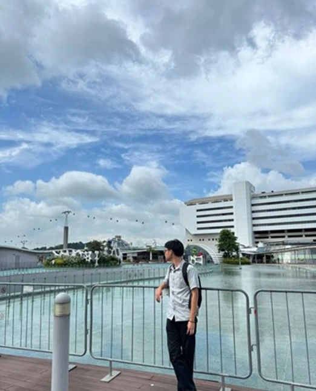<br><b>Bintang Raffi Pasha Islami</b><br><sub>Sound Designer</sub></td>
    <td align="center" width="25%">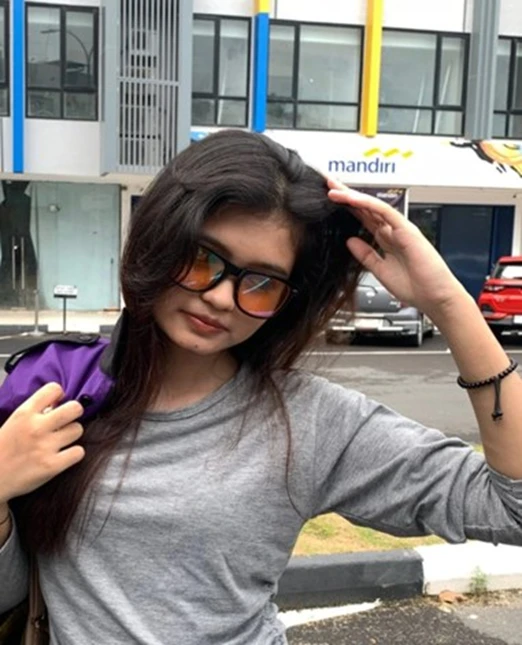<br><b>Zahara Febriani Ahmad</b><br><sub>2D Artist (Zombie)</sub></td>
  </tr>
</table>

---

## 🛠️ Untuk developer

Website ini file statis biasa (HTML, CSS, JavaScript murni). Nggak perlu build, nggak perlu install apa-apa.

```
├── index.html        struktur halaman
├── css/style.css     tampilan (warna dan bentuk dari OUTBREAK UI KIT v9)
├── js/main.js        semua isi yang bisa diganti ada di bagian atas file ini
├── assets/           gambar, sprite, audio, foto tim
├── docs/readme/      gambar untuk README ini
└── CNAME             subdomain GitHub Pages (outbreak.zura-w.my.id)
```

### Buka di komputer sendiri

Klik dua kali `index.html`. Atau, biar sama persis dengan versi online, jalankan server kecil dari folder ini lalu buka `http://localhost:8000`:

```
npx serve -l 8000 .
```

### Mengganti isi

Semua yang perlu diubah ada di bagian atas `js/main.js`:

| Bagian | Isi |
|---|---|
| `CONFIG.links` | Discord, YouTube, Facebook, email, press kit. Link kosong otomatis tampil "Coming soon". |
| `CONFIG.stores` | Tombol Windows PC / itch.io / Google Play. Link kosong otomatis tampil "Coming soon". |
| `CONFIG.trailerYouTubeId` | ID video trailer YouTube |
| `CONFIG.newsletterAction` | URL form newsletter (misalnya Formspree) |
| `HEROES` | Data hero. `soon: true` = tampil siluet + "Coming soon". |
| `ZONES`, `ROADMAP`, `NEWS`, `TEAM` | Misi, roadmap, berita, tim |

Setelah mengubah CSS atau JS, naikkan angka `?v=` di `index.html` (misalnya `1.2.6` jadi `1.2.7`) supaya browser pengunjung nggak pakai file lama.

### Update website online

Website di-host di **GitHub Pages** dari branch `main` (folder root) dengan custom domain `outbreak.zura-w.my.id`. Setiap commit yang di-push ke `main` otomatis online dalam 1-2 menit.

```
git add -A
git commit -m "Update website"
git push
```

DNS-nya: record `CNAME` dengan nama `outbreak` yang mengarah ke `tontonanku.github.io`.

### File download game

GitHub menolak file di atas 100 MB. Kalau zip build Windows lebih besar dari itu, upload ke itch.io atau GitHub Releases, lalu tempel link-nya di `CONFIG.stores`.

---

<p align="center">
  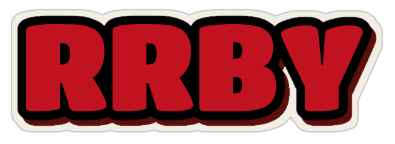<br>
  <sub>© 2026 RRBY Studio. All rights reserved. Made with Unity 6.</sub>
</p>
